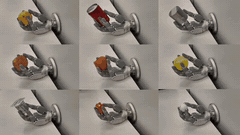
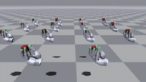
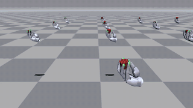
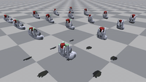

# Sharpa in-hand manipulation for UniLab

[中文](README_zh.md) | [Documentation](docs/README.md)

## Overview

This repository is a complete UniLab research stack for tactile in-hand
manipulation with a 22-DoF Sharpa Wave hand. It bundles the Manager-Based
MuJoCo/MJWarp/MotrixSim task, robot and object assets, grasp caches,
deterministic fixed-scene evaluation, checkpoint tooling, and video playback.
SuperMimic, PPO, APPO and FlashSAC train the same cylinder-rotation task. The
standard pipeline learns a privileged HORA teacher and distills it into an
observation-only student; SuperMimic can alternatively train the deployable
actor directly in one stage through a learned differentiable world model.

## Results

### SuperMimic single-stage training

The optional single-stage SuperMimic path trains an observation-only,
directly deployable actor without teacher/student distillation. Its actor uses
the 147-dimensional observation history while its training critic retains
privileged state. On one RTX 4090 with MJWarp, it completed 3,000 iterations
and 3,971,072 transitions in 686 seconds—5,789 transitions per second.

Both policies use the same fixed 240-scene manifest and 20-second evaluation
window:

| SuperMimic policy | Distillation | Return | Fixed-window rotation speed (rad/s) | Rotation angle (rad) | Survival (s) | Drop rate |
| --- | --- | ---: | ---: | ---: | ---: | ---: |
| Privileged teacher | Required before deployment | 45.33 | 0.784 | 15.68 | 19.56 | 1.25% |
| Single-stage direct actor | None | 43.59 | 0.671 | 13.42 | 19.41 | 2.08% |

The direct actor reaches 43.59 return, rotates the cylinder by 13.42 rad, and
stays alive for 19.41 seconds while eliminating the separate distillation stage.

## Demonstrations

| Real robot | APPO | FlashSAC | SuperMimic direct |
| --- | --- | --- | --- |
|  |  |  |  |

## Manager-Based API

Sharpa Wave dexterous in-hand rotation uses UniLab's **Manager-Based API**. The
task owns action, observation, reset, event, termination and reward terms while
UniLab remains an external dependency and owns the manager lifecycle and
simulation backends.

All four algorithms share the HORA teacher policy and student distillation pipeline
by default. SuperMimic additionally supports an observation-only single-stage actor
with a privileged training critic. Critics retain the V/Q structure required by each algorithm.

## Installation and validation

UniLab 1.5.6 and its CUDA Torch wheels are resolved from the configured package
indexes.

```bash
git clone https://github.com/unilabsim/sharpa_rl_unilab.git
cd sharpa_rl_unilab
uv sync
uv run pytest
uv run pyright
```

To install the source tree with pip instead, use `pip install .` in a separate
virtual environment. The MuJoCo, MJWarp and MotrixSim runtimes are installed by
default; select an algorithm's available backend with `--sim`. MJWarp requires
CUDA. Training uses
UniLab's integrated tensor-native RL runtime: PPO/APPO collection and FlashSAC
inference/replay keep observations, actions, rewards, and done flags on Torch
tensors, and CUDA runs keep the training hot path device-resident.
`uv run pytest` runs fast regression tests by default; use
`uv run pytest -m slow` for simulation and training smoke tests.
The FlashSAC smoke test requires CUDA.

## Quick start

After installation, run from the repository root to train SuperMimic, PPO, APPO
and FlashSAC in sequence for Sharpa Wave in-hand cylinder rotation:

```bash
uv run sharpa-compare
```

In another terminal, start TensorBoard and open <http://localhost:6006> to view training curves:

```bash
uv run tensorboard --logdir logs/compare
```

Each algorithm saves its playback video after training to
`logs/compare/seed_<seed>_<timestamp>/<algorithm>/play_video.mp4`.

## Train, evaluate and distill

```bash
uv run sharpa-train --algo supermimic
# Optional single-stage SuperMimic without teacher/student distillation:
uv run sharpa-train --algo supermimic algo.single_stage=true
uv run sharpa-train --algo appo
uv run sharpa-train --algo flashsac
uv run sharpa-train --algo ppo
```

`--cfg` prints the composed Manager-Based configuration. Append Hydra overrides
to the command for tuning.

Default training saves `teacher_final.pt`; optional single-stage SuperMimic saves
a directly evaluable `policy_final.pt`. Training records `play_video.mp4` in the same
directory. Headless Linux machines use EGL or OSMesa for offscreen rendering; on
Ubuntu/Debian, install `libegl1` with a working NVIDIA graphics driver, or `libosmesa6`
for software rendering. `uv sync` does not install these system dependencies; set
`training.no_play=true` if recording is not needed.

SuperMimic uses mixed Muon/Adam optimizers by default: Muon updates hidden actor
and world-model weight matrices, while input/output layers, vectors, normalizers,
and the critic remain on Adam. Set `algo.pi_opt=adam` and/or `algo.wm_opt=adam`
to restore Adam for either network.

For evaluation and HORA distillation, specify the checkpoint file directly:

```bash
uv run sharpa-eval --checkpoint /absolute/path/to/policy_final.pt
uv run sharpa-eval --checkpoint /absolute/path/to/teacher_final.pt
uv run sharpa-distill --checkpoint /absolute/path/to/teacher_final.pt
uv run sharpa-eval --checkpoint /absolute/path/to/student_final.pt
```

`uv run sharpa-compare` trains the four algorithms sequentially using their
default configurations; append `--distill --eval --num-seeds 3` to run distillation
and evaluation across multiple seeds. Each algorithm uses its own training budget; equal sample counts or compute costs
are not guaranteed.

See [in-hand rotation](docs/en/task.md) for task background and the
[training guide](docs/en/training.md) for detailed steps, runtime setup and
checkpoint compatibility.

## Task contract

- Object-scale randomization uses the fixed model-variant catalog
  `scene_scale_0.8.xml` … `scene_scale_1.5.xml`, keeping scene topology stable
  across scale samples.
- Fixed-variant body geoms have unique names for reliable
  `mjbatch.VariantPack` selection.
- Each variant retains `simple="false"` on the free object so reset-time mass
  and center-of-mass sampling remains consistent.
- Tactile smoothing/latency, privileged state, incremental position targets,
  randomized actuator gains, object mass/CoM/friction/gravity and decaying
  object forces are explicit manager terms that access state through the Entity
  facade.

See [architecture](docs/en/architecture.md).
