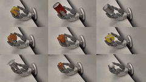
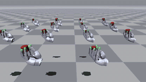
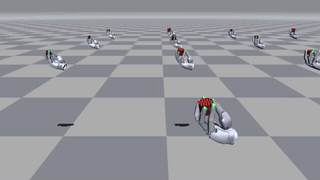
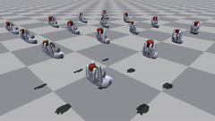

# UniLab Sharpa 手内操作

本仓库是一套面向 Sharpa Wave 22 自由度灵巧手的 UniLab 触觉手内操作研究栈，
包含 Manager-Based MuJoCo/MJWarp/MotrixSim 任务、机器人与物体资产、grasp cache、
固定场景确定性评估、checkpoint 工具和视频回放。SuperMimic、PPO、APPO、
FlashSAC 训练同一个圆柱旋转任务：标准流程先训练特权 HORA teacher，
再蒸馏为仅观测 student；SuperMimic 也可通过可微世界模型单阶段直接训练可部署 actor。

## 结果

### SuperMimic 单阶段训练

可选 SuperMimic 单阶段路径直接训练仅观测、可部署的 actor，无需
teacher/student 蒸馏；actor 使用 147 维观测历史，训练 critic 保留特权状态。
在单卡 RTX 4090 与 MJWarp 上，它完成 3000 iterations、3,971,072 transitions，
用时 686 秒，吞吐量 5,789 transitions/s。

两个策略均使用同一份固定 240 场景清单和 20 秒评估窗口：

| SuperMimic 策略 | 蒸馏 | Return | 固定窗口转速 (rad/s) | 旋转角 (rad) | 存活时间 (s) | 掉落率 |
| --- | --- | ---: | ---: | ---: | ---: | ---: |
| 特权 teacher | 部署前需要蒸馏 | 45.33 | 0.784 | 15.68 | 19.56 | 1.25% |
| 单阶段 direct actor | 无 | 43.59 | 0.671 | 13.42 | 19.41 | 2.08% |

direct actor 取得 43.59 return，完成 13.42 rad 旋转，存活 19.41 秒，同时省去了
独立蒸馏阶段。

### SuperMimic Muon 优化器消融

在结构化世界模型上使用 Muon/Adam 混合优化器完成 2 个 MuJoCo direct seed，
并与日志中的 3-seed 无结构化世界模型 Adam baseline 对比；两者使用相同的
240 场景评估清单。

| 方法 | Seeds | Return | 固定窗口转速 (rad/s) | 存活时间 (s) | 掉落率 |
| --- | ---: | ---: | ---: | ---: | ---: |
| 结构化 WM + Muon/Adam | 2 | 30.105 ± 6.765 | 0.708 ± 0.117 | 17.969 ± 1.930 | 17.71% ± 17.97% |
| 无结构化 WM + Adam baseline | 3 | 32.531 ± 2.926 | 0.731 ± 0.012 | 19.108 ± 0.618 | 6.53% ± 3.87% |

这次复用 Adam 学习率的探索性实验没有超过 baseline，且两个 seed 的结果差异较大。
完整协议、逐 seed 结果、训练成本和混杂因素见
[实验报告](docs/experiments/2026-11-03-supermimic-muon-optimizer.md)（英文）。

## 演示

| 真实机器人 | APPO | FlashSAC | SuperMimic direct |
| --- | --- | --- | --- |
|  |  |  |  |

## Manager-Based API

Sharpa Wave 灵巧手手内旋转任务使用 UniLab 当前 **Manager-Based API**。任务
拥有 action / observation / reset / event / termination / reward terms；
UniLab 保持外部依赖，负责 manager 生命周期与仿真后端。

四种算法默认共享 HORA teacher 训练与 student 蒸馏流程。SuperMimic 额外
支持带特权训练 critic 的仅观测单阶段 actor；各算法保留自己的 V/Q critic 结构。

## SuperMimic 训练亮点

可选 direct 路径无需 teacher/student 蒸馏，但训练时仍保留特权 critic。在单
seed、单卡 RTX 4090 的 MJWarp 验证中，该路径完成 3000 iterations
（3,971,072 transitions）用时 686 秒。下表两个策略均使用同一份固定 240 场景
清单评估：

| SuperMimic 路径 | Return | 固定窗口转速 (rad/s) | 旋转角 (rad) | 存活时间 (s) | 掉落率 |
| --- | ---: | ---: | ---: | ---: | ---: |
| 默认特权 HORA teacher | 45.33 | 0.784 | 15.68 | 19.56 | 1.25% |
| 可选仅观测 direct actor | 43.59 | 0.671 | 13.42 | 19.41 | 2.08% |

以上为单 seed 的任务内仿真结果。与 [Awesome SuperMimic](https://github.com/miao-org/awesome-supermimic)
收录的其他社区报告一样，跨项目比较前必须考虑奖励、任务时域与评测协议差异。

## 安装与校验

UniLab 1.5.6 及其 CUDA Torch wheel 会从已配置的包索引解析。

```bash
git clone https://github.com/unilabsim/sharpa_rl_unilab.git
cd sharpa_rl_unilab
uv sync
uv run pytest
uv run pyright
```

若使用 pip，可在独立虚拟环境中运行 `pip install .`。默认安装 MuJoCo、
MJWarp 和 MotrixSim 运行时，并通过 `--sim` 选择算法可用的后端。MJWarp
需要 CUDA。训练使用
UniLab 集成的 tensor-native RL runtime：PPO/APPO 采样与 FlashSAC
推理/replay 的观测、动作、奖励和结束标志均保持 Torch tensor 边界，CUDA
训练热路径驻留 GPU。
`uv run pytest` 默认运行快速回归测试；仿真与训练冒烟测试使用
`uv run pytest -m slow`，其中 FlashSAC 冒烟测试需要 CUDA。

## 快速上手

安装完成后，在仓库根目录一键依次训练 SuperMimic、PPO、APPO、FlashSAC，让 Sharpa Wave 手学习手内旋转圆柱体：

```bash
uv run sharpa-compare
```

另开终端启动 TensorBoard，浏览器打开 <http://localhost:6006> 查看训练曲线：

```bash
uv run tensorboard --logdir logs/compare
```

每种算法训练结束后，回放视频保存至
`logs/compare/seed_<seed>_<时间戳>/<算法>/play_video.mp4`。

## 训练、评估与蒸馏

```bash
uv run sharpa-train --algo supermimic
# 可选单阶段 SuperMimic，不走 teacher/student 蒸馏：
uv run sharpa-train --algo supermimic algo.single_stage=true
uv run sharpa-train --algo appo
uv run sharpa-train --algo flashsac
uv run sharpa-train --algo ppo
```

`--cfg` 可打印合成后的 Manager-Based 配置。可在命令末尾追加 Hydra 参数覆盖。

默认训练结束后保存 `teacher_final.pt`，可选单阶段 SuperMimic 保存可直接评估的
`policy_final.pt`，并在同目录录制 `play_video.mp4`。无显示器的 Linux 机器使用
EGL 或 OSMesa 离屏渲染；Ubuntu/Debian 需要安装 `libegl1` 并使用可用的 NVIDIA
图形驱动，或安装 `libosmesa6` 使用软件渲染。`uv sync` 不会安装这些系统依赖；
无需录制时可设置 `training.no_play=true`。

SuperMimic 默认使用 Muon/Adam 混合优化器：隐藏层 actor 与世界模型权重矩阵使用
Muon，输入/输出层、向量、归一化参数和 critic 仍使用 Adam。可用
`algo.pi_opt=adam` 和/或 `algo.wm_opt=adam` 将对应网络恢复为 Adam。

评估与 HORA 蒸馏直接指定 checkpoint 文件：

```bash
uv run sharpa-eval --checkpoint /absolute/path/to/policy_final.pt
uv run sharpa-eval --checkpoint /absolute/path/to/teacher_final.pt
uv run sharpa-distill --checkpoint /absolute/path/to/teacher_final.pt
uv run sharpa-eval --checkpoint /absolute/path/to/student_final.pt
```

`uv run sharpa-compare` 按默认配置依次训练四种算法；追加
`--distill --eval --num-seeds 3` 可运行多 seed 蒸馏与评估。各算法使用各自的训练预算，
不保证等采样量或等计算成本。

任务背景见[手内旋转](docs/zh_CN/task.md)，操作步骤、运行配置和 checkpoint 兼容范围
见[训练指南](docs/zh_CN/training.md)。

## 任务契约

- 物体尺寸随机化使用 fixed model variants
  （`scene_scale_0.8.xml` … `scene_scale_1.5.xml`），使不同 scale 样本保持稳定的
  scene topology。
- fixed variant 中所有 body geom 均唯一命名，保证
  `mjbatch.VariantPack` 选择可靠。
- 所有 variant 的自由物体保留 `simple="false"`，使 reset 时的质量与质心采样保持一致。
- 触觉平滑/延迟、特权信息、位置目标、执行器增益、物体质量/质心/摩擦/重力与
  衰减外力均为显式 manager terms，仅通过 Entity facade 访问状态。

详见 [架构](docs/zh_CN/architecture.md)。
